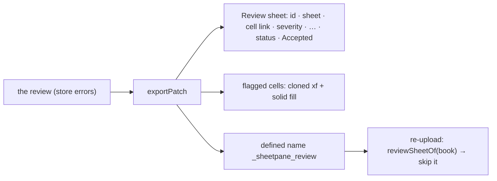

# SR-REVIEW — @sheetpane/review

## §1 — For humans

**The review travels inside the file.** On download, the plugin adds a
*Review* sheet: one row per error, each with a link to its cell. A reviewer
works the list in Excel, fixes the file and uploads it again. Optionally,
every flagged cell is filled by its severity.

**The user's own cells and formatting stay.** A flagged cell keeps its
format: only its fill changes. Every other cell keeps its exact bytes, and a
sheet the user already called *Review* is never overwritten.



<details>
<summary><b>ASCII twin</b> — the same diagram, for terminals and diffs</summary>

```text
   the review (store errors) -> exportPatch
       -> Review sheet (one row per error, Cell = internal hyperlink)
       -> flagged cells: their own xf cloned with a solid fill (optional)
       -> defined name _sheetpane_review  -> re-upload: reviewSheetOf(book) -> skip
```

</details>

---

## §2 — For agents

### Context

pdfsuite's spec intake (SR-SPEC-INTAKE decision 14) needs an *annotated
workbook*: every error cell filled red and a sheet listing the errors, to fix
in Excel and re-upload. `@sheetpane/comments` (SR-COMMENTS) already writes the
review as comments. This plugin writes the same review as a table. W-59.

### Decision

1. **The package:** `@sheetpane/review` — `review(options)` (`id: 'review'`,
   `provides: ['exportPatch']`, `lastExport`), registered as `review` on
   import. Also exported: `reviewSheetOf`, `REVIEW_NAME`, `COLUMNS`,
   `PROBLEM_SEVERITIES`, `DEFAULT_FILLS`, `MAX_FILL_CELLS` and the
   `ReviewOptions`, `ReviewReport`, `SkipReason` and `ReviewPlugin` types.
   `@sheetpane/grid` is a peer; `@sheetpane/export` (its OOXML helpers) is
   the one runtime dependency. String XML only, so it runs in Node. **No new
   core hook:** the existing `exportPatch` context writes a part, adds a
   relationship and sets a content type, which is all this needs (SR-EXPORT
   is unchanged). There are no controls. `exportOptions` adds two items to
   the Download menu (W-34): *Add a Review sheet* (`review`, default
   `options.sheet !== false`) and *Colour flagged cells* (`reviewFills`,
   default `options.fill === true`).
2. **What is listed:** every error in the store except the file's own
   comments (`author: 'file'`). Only the severities in `severities` are
   listed: the default is `error`, `warning` and `note`, and results such as
   `pass` and `skipped` (W-50) appear only when named. Only the layers in
   `layers` are listed (W-51): the default is every layer, and an error with
   no `layer` is `review`. `export({ reviewSeverities, reviewLayers })`
   overrides both for one export. **An empty selection writes nothing.**
   *Until W-50 and W-51 merge, `layer` is read defensively and `severities`
   is `string[]`; the orchestrator tightens the types after the merge.*
3. **The sheet:** a new worksheet part (`xl/worksheets/sheetN.xml`, the first
   free N), a worksheet relationship from the workbook, an `<Override>`
   content type, and a `<sheet>` added last (`sheetId` = max + 1). The
   relationships namespace is bound on the root if it is missing. Cells are
   **inline strings**, so `sharedStrings` is never touched, at most 32,767
   characters each and cleaned of characters XML forbids. Columns, left to
   right: ID, Sheet, Cell, Severity, Type, Found, Expected, Message, Author,
   Status, Accepted, Accepted by, Accepted at. The header row is frozen.
   Rows come in this order: workbook errors, then each sheet in the file's
   order, with its whole-sheet errors first and then its cells from top to
   bottom and left to right.
4. **Links:** the Cell column holds an internal `<hyperlink location>`
   (`'Q3 ''final'''!B2`), which needs no relationship. A whole-sheet error
   (W-55) reads *Whole sheet* and links to its A1. A workbook error reads
   *Whole workbook* and has no link. An error whose sheet the file lacks has
   no link.
5. **Names:** the name is `sheetName` (default `Review`), with `[ ] : * ? / \`
   and apostrophes at either end removed, cut to 31 characters. If a sheet
   already has that name (compared ignoring case, as Excel does), the plugin
   adds `Review (2)`, `(3)`… within 31 characters. **A user's sheet is never
   overwritten.**
6. **The marker:** a workbook-scoped, hidden defined name `_sheetpane_review`
   over the table (`'Review'!$A$1:$M$n`), placed in schema position.
   `reviewSheetOf(book)` reads it from what `@sheetpane/import` returns, so a
   host can skip the sheet on re-upload. **Exported again**, a file whose
   marker names an existing sheet with no relationships of its own has that
   sheet rewritten in place, keeping its name and position. If someone gave
   the sheet comments or a drawing in Excel, it is left alone and a new sheet
   is added.
7. **Accepted errors (W-69, SR-ERRORS 14, SR-GRID 5c):** listed with Status
   *Accepted* and *Accepted: \<reason\>*, with who (`acceptedBy`, else the
   author) and when (`acceptedAt`, UTC). They are **never filled** and are
   counted apart from open errors in `lastExport.counts` (`{ open, accepted,
   resolved }`). Resolved errors are listed and never filled.
8. **Fills (optional):** each **open** error at a cell, whose severity has a
   colour, fills the cells of its range. The defaults are `error` FFFFC7CE,
   `warning` FFFFEB9C and `note` FFDDEBF7, and `fills` overrides them (`null`
   turns one off; a value that is not a colour throws SP-5905). The cell's
   own `xf` is **cloned** with a solid fill (`fillId`, `applyFill="1"`), once
   per format and colour. Fills and formats are only ever **appended** to
   `styles.xml`, and its counts are updated. Only a flagged cell's `s` is
   written. **Every other row and cell is byte-identical.** A flagged cell
   the file lacks is added empty, styled from its row (`customFormat`) or
   column, in column order. A missing row is created in row order, and
   `spans` and `<dimension>` are widened. When a cell has two severities, the
   worse one wins. The header row takes a grey fill, not bold: **no font is
   written** (SR-LAW-5).
9. **Not coloured, reported in `lastExport.skipped`:** `no-cell` (a
   whole-sheet or workbook error, W-55 — listed only), `no-sheet`,
   `bad-range`, `range-capped` (a range over `MAX_FILL_CELLS` = 10,000 colours
   only the cells the file has, SP-5903), `no-styles` (no readable styles
   part, SP-5904; the sheet is still written) and `unreadable-part` (the
   sheet could not be read, so it is left as it was, SP-5902). If the
   workbook part cannot be read, no sheet is written (SP-5901, logged).
10. **Scope:** an `.xlsx` download of an `.xlsx` only. Core never runs
    `exportPatch` for a CSV, or for a CSV converted to `.xlsx` (SR-LAW-3).
    The parts go into the bytes the browser saves, and nothing is sent
    anywhere (SR-LAW-11).

### Consequences

- **Enforced today:** `packages/review/test/` (Chromium):
  - `sheet.test.ts` covers the part, relationship, content type, `<sheet>`
    and marker (all well-formed), the order, the text, the links, every
    other part byte-identical to a plain export, the `Review (2)` collision,
    name cleaning, an apostrophe in a link, export twice → one sheet, the
    switches, the severity and layer filters, accepted rows and counts, and
    the read-back through `@sheetpane/import` (`reviewSheetOf`) and
    `@sheetpane/testing` (`readFile`, `valueAt`).
  - `fills.test.ts` covers the cloned formats (number format, font, border
    and alignment kept), untouched cells byte-identical, added cells and
    rows, spans and dimension, the worse fill winning, accepted and resolved
    never filled, `no-cell`, dedup, custom fills, SP-5905, SP-5903 and
    SP-5904.
  - `roundtrip.test.ts` runs the showcase and the exceljs fixture with
    `@sheetpane/comments` on the same export.
  - `package.test.ts` checks for no font, no DOM, no network call (L11) and
    the dependencies.
  - The demos' gallery tab *Review sheet* and its `demo-check` step (L10).
- **Not done:** opening a download in real Excel, with every link going to
  its cell and no repair prompt, is part of W-30 DoD 3. An autoFilter on the
  header is not written.

### Alternatives considered

- **Shared strings:** rejected. Extending `sharedStrings.xml` touches a part
  every sheet reads; inline strings are local to the new sheet.
- **A new core hook to add a sheet:** rejected. The `exportPatch` context
  already writes parts, relationships and content types.
- **Bold header:** rejected. It writes a `<font>`, and the header is marked
  with a fill instead (SR-LAW-5's spirit: sheetpane adds no font).
- **Always adding a new sheet on re-export:** rejected. Review sheets would
  pile up. The marker lets the plugin replace its own sheet, and a sheet
  someone extended in Excel is still kept.

### Reference (required)

- [`packages/review/`](../packages/review/)

### Veto condition

**Reopen this decision if:** Excel or LibreOffice repairs a downloaded file,
does not follow a link (W-30), or hosts need the Review sheet kept beside an
earlier one rather than replacing it.

**How to check it:** `pnpm exec vitest run --project review`

---

## References

*Every source this record cites, gathered in one place. An archived document
is never listed here.*

**Records** — [SR-EXPORT](0103_EXPORT.md) · [SR-GRID](0105_GRID.md) · [SR-ERRORS](0106_ERRORS.md) · [SR-COMMENTS](0112_COMMENTS.md) · [SR-CODES](0117_CODES.md) · [SR-BUILD](0102_BUILD.md)

**Code**

- [`packages/review/src/index.ts`](../packages/review/src/index.ts) · [`write.ts`](../packages/review/src/write.ts) · [`sheet.ts`](../packages/review/src/sheet.ts) · [`fills.ts`](../packages/review/src/fills.ts) · [`rows.ts`](../packages/review/src/rows.ts)
