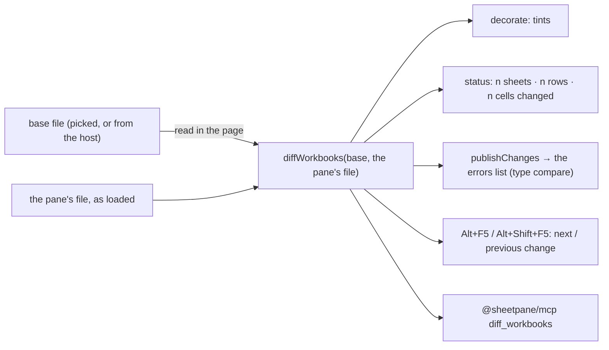

# SR-COMPARE — @sheetpane/compare

## §1 — For humans

**What changed since the version that was approved?** A reviewer picks the base file (or the host
hands it over); the pane marks every added, removed, moved and changed row and cell, the status
line says how much changed, and Alt+F5 walks through the changes. The same diff runs in Node and
answers an agent through the MCP server.



<details>
<summary><b>ASCII twin</b> — the same diagram, for terminals and diffs</summary>

```text
   base file (picked / from the host) --read in the page--+
   the pane's file, as loaded --------------------------> diffWorkbooks
        -> decorate (tints) -> status line (summary) -> errors list (publishChanges, type compare)
        -> Alt+F5 / Alt+Shift+F5 (next / previous change)   -> @sheetpane/mcp diff_workbooks
```

</details>

---

## §2 — For agents

### Context

pdfsuite's reviewers change a PDF template from a spec workbook; *what changed since the last
approved spec* tells them which pages to re-test (W-63, Group 3). Excel's own Spreadsheet Compare
runs only on Windows with some enterprise Office editions; `daff` (MIT) aligns table rows but knows
no sheets or merges — a reference for row alignment, not a dependency (SR-LAW-2: none is added).

### Decision

1. **The package:** `@sheetpane/compare`. The root is headless and side-effect free —
   `diffWorkbooks`, `applyDiff`, `summaryText`, `relativeFormula` and their types — and runs in
   Node and the browser. `@sheetpane/compare/ui` is the plugin (`id: 'compare'`, registered for the
   `plugins` attribute) with `compareWith`, `clearCompare`, `comparison`, `stepChange` and
   `publishChanges`. Dependencies `@sheetpane/export` and `@sheetpane/import`; `@sheetpane/grid` an
   optional peer (the `/ui` entry only). No third-party code.
2. **Sheets** match by name. An unmatched sheet of the newer workbook whose distinct rows are mostly
   an unmatched older sheet's (rows in common over rows in either ≥ `renameThreshold`, default 0.5;
   the most alike pairs first) is *renamed*; the rest are added or removed. The result lists the
   newer workbook's sheets in its order, removed sheets last.
3. **Columns** match by header-row title (trimmed, ignoring case; `headerRow`, default 1) when both
   header rows hold two or more titles and no title twice; columns left over pair in order when
   both sides have the same number left (a renamed title). Otherwise by position. Columns whose
   order changed are reported as moved (the longest in-order run stays).
4. **Rows.** With `key` columns (titles or letters; for every sheet, or per sheet with `'*'` as the
   default) rows at or above the header row pair by position and data rows by key — the n-th row
   of a key with the n-th; a pair outside the longest in-order run is **moved**; a row whose key
   cells are blank matches only a row with the same content and is never called moved. Without a
   key, rows align on their content (patience anchors — rows unique on both sides, kept in order —
   and Myers' diff inside each gap, capped at 1,000 edits a gap), and inside each gap rows alike
   enough (half or more of the filled cells equal) pair as **changed**; a row that changed place
   is removed and added, never moved (W-63's hazard: *moved* only when certain). Of two in-order
   runs of the same length, the one whose rows sit nearer their old places wins. Trailing blank
   rows do not count.
5. **Cells** of rows both versions hold differ by value, display text or formula; formulas are
   compared with each relative reference written as an offset from its cell, so a formula that
   only moved with its row is not a change. A new column's filled cells are changes with `was:
   null`. Also reported per sheet: merges added and removed (mapped through the alignment), rows
   and columns newly hidden or shown, the sheet's state, and data-validation and
   conditional-format rule counts when they differ.
6. **The result** is plain data (L9): per sheet a status, the row operations (`added` with its
   values, `removed` after the newer row it followed, `changed`, `moved`), the cell changes (`was`
   and `now`: value, text, formula; `what` differs), counts, and a summary — sheets, rows and cells
   changed (a removed or added sheet's rows count). `applyDiff(a, diff)` rebuilds the newer
   version's values; a key named for one sheet that both versions lack is SP-5901, a key named for
   every sheet is used only where it exists (the sheet carries a `note`).
7. **Speed:** two versions of a 50,000-row, 8-column sheet (500 cells edited, 100 rows inserted,
   100 deleted, 50 moved), and the same sheet with every row changed, each diff in under **500 ms**
   in Node. Recorded 2026-10-19 on an Apple M4 (10 cores, 16 GB, macOS) under a load average of
   14–17 from six other build lanes: unkeyed 120 ms, keyed 119 ms, every row changed 138 ms.
   With `CI` set the time is reported, not asserted.
8. **The comparison in a pane** is the file as loaded (`store.book`) against the base, never the
   pane's edits since; another file loaded into the pane is compared with the same base. The base
   comes from Compare… (a file picker; `.xlsx` or `.csv`) or from the host (`compareWith(store,
   bytes | File | workbook, { name, key, headerRow })`); either way it is read in the page and
   nothing is sent (SR-LAW-11 decision 2). A base that cannot be read is said in the status line.
9. **Tints** (`decorate`, after `styles` and `condfmt`): changed cell amber, added row or column
   and every cell of an added sheet green, moved row blue, a red top border on the row below
   removed rows (bottom border on the last row when they were at the end) — each a
   `--sp-compare-*` custom property with a default that reads on light and dark.
10. **The status line** (`status` slot, View and Edit): *Compared with ‹name›: n sheets · n rows ·
    n cells changed*, and the removed sheets by name.
11. **Keys and buttons** (cell bar, View and Edit): Compare…, Previous change (Alt+Shift+F5), Next
    change (Alt+F5) — VS Code's keys for the same act; F-keys keep ⌥ from changing the key on a Mac
    — and Stop comparing. Stops are sheet-level notes, new columns, added, moved and removed rows
    (the row selected) and changed cells, in sheet, row, column order, wrapping.
12. **The errors list** (L7: every surface shows the same comparison): each change is an error
    of type `compare`, severity `note`, author `compare` — a sheet added or renamed and a sheet's
    structural changes at A1, a column added, a row added or moved (the row), removed rows (the
    row below them), a changed cell (`was … → now …`, formulas named) — at most 2,000 and one note
    for the rest. `found` is the file's text (as for every error) and `expected` what the base
    holds there — the base's text, its formula when only the formula changed, a moved row's old
    row — so the list reads *now → base*. They are written by one function, `publishChanges`, which today replaces the
    list through `setErrors` keeping every other error (it clears undo) and with review layers
    (W-51) becomes the `compare` layer. A removed sheet has no place in the workbook: the status
    line names it.
13. **MCP:** `@sheetpane/mcp`'s `diff_workbooks(base, path, key?, headerRow?, limit?)` runs
    `diffWorkbooks` on two local files, the key for every sheet (SR-MCP).

### Consequences

- **Enforced today:** `packages/compare/test/diff.node.test.ts` — fast-check: a workbook diffed
  with itself is empty; the diff applied to `a` gives `b`'s values for any two workbooks, keyed or
  not; a keyed shuffle is only moves — and the alignment, column, formula, sheet and structure
  cases; `perf.node.test.ts` the budget (decision 7); `fixtures.node.test.ts` the fixtures pair
  (SR-FIXTURES `compare/`); `compare.test.ts` (Chromium) the tints, the status line, the errors
  list, the keys and buttons, Stop comparing and a second file; `packages/mcp/test` the tool's
  golden; the demos' gallery tab *Compare* and its `demo-check` step (SR-BUILD 11a).
- **Not done:** the `compare` layer — `publishChanges` writes through `setErrors` until W-51; a
  removed sheet's changes have no place to be listed (W-55's sheet-level errors would give them
  one); comparing the pane's edits, not the file, is W-64's edits view.

### Alternatives considered

- `daff` as a dependency — rejected: rows only, no sheets, merges or formulas, and SR-LAW-2 asks for
  none where the code is this small.
- Report a reordered row as moved without a key — rejected: equal rows make it a guess (W-63's
  hazard).
- Compare the pane's live values (edits included) — rejected for now: every edit would rewrite the
  errors list and clear undo until layers land; the file against the file is the question asked.

### Reference (required)

- [`packages/compare/`](../packages/compare/) · W-63 · Myers, *An O(ND) Difference Algorithm and
  Its Variations* (1986) · Bram Cohen's patience diff.

### Veto condition

**Reopen this decision if:** a host needs moved rows without a key, the 50,000-row budget fails on
an idle machine, or W-51's layers change how a plugin writes errors.

**How to check it:** `pnpm exec vitest run --project node packages/compare && pnpm exec vitest run --project compare`

---

## References

*Every source this record cites, gathered in one place. An archived document
is never listed here.*

**Records** — [SR-GRID](0105_GRID.md) · [SR-ERRORS](0106_ERRORS.md) · [SR-IMPORT](0104_IMPORT.md) · [SR-MCP](0119_MCP.md) · [SR-FIXTURES](0115_FIXTURES.md) · [SR-CODES](0117_CODES.md) · [SR-BUILD](0102_BUILD.md) · [SR-LAW-11](0013_LAW-11-workbook-stays-in-the-browser.md)

**Code**

- [`packages/compare/src/diff.ts`](../packages/compare/src/diff.ts) · [`align.ts`](../packages/compare/src/align.ts) · [`ui.ts`](../packages/compare/src/ui.ts)
