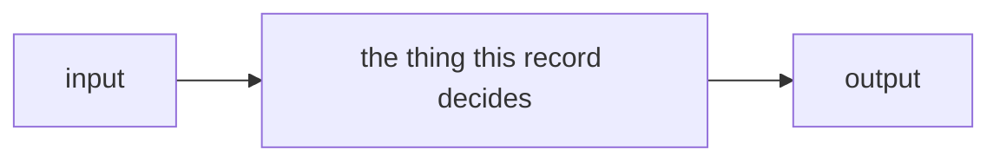

# SR-<NAME>: <short decision title>

> Copy to `records/NNNN_<short-name>.md`; take the next free number in the
> record's own range (register §The convention). Cite the NAME everywhere.
> Delete these blockquotes as you fill it in.
>
> | key | value |
> |---|---|
> | `type` | `Standing Record` |
> | `kind` | `law` · `component` · `process` |
> | `name` | `SR-<NAME>` |
> | `title` | `SR-<NAME> (NNNN) — <short decision title>` |
> | `description` | one sentence; what the record decides |
> | `status` | `proposed` · `accepted` · `superseded` · `archived` |
> | `date` | `YYYY-MM-DD` — when the decision was taken |
> | `feature` | the one feature this record belongs to |
> | `owns` | component paths this record claims, `[]` when none; must match the register's Ownership table |
> | `laws` | `[L0, L1]`-style list, `[]` when none; never restate a law |
> | `timestamp` | ISO 8601 |
> | `content_sha` | `""` until a stamping script exists |
> | `supersedes` / `ratifies` | optional — the record replaced / the work item whose ruling this records |
>
> **A record states what is true now and carries no history.** Rewrite the
> changed sentence in place; no `Amended` sections.

---

## §1 — For humans

<Two or three short paragraphs: what this decides and why anyone should care.
Present tense.>



<details>
<summary><b>ASCII twin</b> — the same diagram, for terminals and diffs</summary>

```text
   +-------+      +------------------------------+      +--------+
   | input | ---> | the thing this record decides| ---> | output |
   +-------+      +------------------------------+      +--------+
```

</details>

---

## §2 — For agents

### Context

What forces are at play? What problem does this solve? Why now?

### Decision

Numbered, present tense, imperative where it binds, so another record can cite
`decision 3`.

### Consequences

What becomes easier, harder, owed. Name the debt: a `B-nnn` row in
`work/BACKLOG.md` if nobody is doing it, a `W-nn` if someone is.

### Alternatives considered

One line per option minimum, and why each lost. A real fork links its
`work/compare/` doc.

### Reference (required)

At least one grounding reference — code at a path, a live doc, measured
evidence. **Never an archived doc.**

### Veto condition

**Reopen this decision if:** <the checkable condition>

**How to check it:** `<command or the exact place to look>`

---

## References

*Every source this record cites, gathered in one place. An archived document
is never listed here.*

**Records** — [SR-<NAME>](NNNN_<short-name>.md)

**Code**

- [`<path>`](../<path>)

**Project docs**

- [`work/compare/<fork>.compare.md`](../work/compare/<fork>.compare.md)
